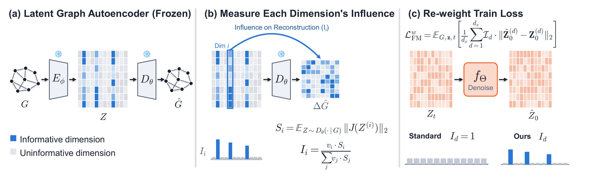

# NOT ALL LATENTS ARE EQUAL: IMPORTANCE-WEIGHTED LATENT GRAPH GENERATION

## Description

Latent graph generation trains a flow-matching (or diffusion) model over the latent space of a frozen
graph autoencoder (VGAE). In practice, only a handful of latent dimensions actually matter to the
decoder — the rest carry little to no structural signal — yet a plain per-dimension MSE loss spends equal
gradient budget on all of them.

This repo implements **Jacobian-weighted latent flow matching**: a one-time, per-dimension sensitivity
measurement (decoder-Jacobian × latent variance) that reweights the flow-matching loss to concentrate
training on the dimensions that actually decode into graph structure. The method is a drop-in change to
the training loss only — no architecture change, no extra inference cost, and it is off by default so
every baseline run is byte-for-byte unaffected.

<p align="center">

<p>

**Figure: the overall flow of the Jacobian reweighting method. (a)** The autoencoder architecture,
consisting of both informative and uninformative latent dimensions. **(b)** We add noise to each
dimension to check how the decoder reacts and get the sensitivity measurement, which is then scaled by
the mean posterior variance so the total sensitivity is represented as $I_i$. **(c)** How the weighting
is used in the loss, and the difference between uniform and weighted Jacobian loss.

## Installation

```bash
conda env create -f environment.yml
conda activate ljrw
```

Or run `bash install_env.sh`, which also installs the pip/PyG dependencies in `requirements.txt`.

The synthetic-graph evaluation metrics (degree/clustering/orbit stats) need `orca` compiled once:

```bash
cd evaluation/synthetic/orca && g++ -O2 -std=c++11 -o orca orca.cpp
```

## Weights & Biases (optional)

Each config's `wandb_project`/`wandb_entity` are left as placeholders (`your-wandb-project` /
`your-wandb-entity`), so calling `main_ae.py`/`main_fm.py` directly will try to log to W&B and fail
unless you point them at your own project/entity first:

```bash
# point at your own project/entity for this run
python main_ae.py --config-name=planar_ae_vgae root=outputs/planar \
  wandb_project=<your-project> wandb_entity=<your-entity>
```

or edit those two fields directly in the config files, or disable logging entirely with
`wandb_project=null`. Run `wandb login` first if you haven't already.

`run_datasets.sh` (below) is different: it defaults W&B *off* and only turns it on if you set
`WANDB_PROJECT` yourself.

## Running it: VGAE vs. VGAE + reweighting

Every dataset has three configs: one autoencoder (`<dataset>_ae_vgae`) and two flow-matching variants
that share it — a baseline (`<dataset>_fm_vgae`) and a reweighted one (`<dataset>_fm_vgae_dimreweight`).

```bash
# 1. Train the autoencoder once
python main_ae.py --config-name=planar_ae_vgae root=outputs/planar

# 2. Flow matching -- baseline (no reweighting)
python main_fm.py --config-name=planar_fm_vgae root=outputs/planar

# 2'. Flow matching -- with jacobian reweighting
python main_fm.py --config-name=planar_fm_vgae_dimreweight root=outputs/planar
```

That's it — the reweighting config just sets `dim_reweight=true` (plus, for some datasets, a
`dim_reweight_floor`); everything else about the run is identical to its baseline sibling. The
per-dimension weight is measured once per AE checkpoint (via the decoder-Jacobian probe, using the
encoder's posterior mean as the variance factor) and cached to disk, so the one-time cost is paid
once, never per run or per step.

Datasets provided:

| dataset      | nodes            | reweighted config? |
| ------------ | ---------------- | ------------------ |
| `planar`   | 512              | yes                |
| `planar`   | 64               | —                 |
| `tree`     | 128              | yes                |
| `tree`     | 64               | —                 |
| `sbm`      | ~126 (variable)  | yes                |
| `moses`    | ≤27 (molecular) | yes                |
| `guacamol` | ≤88 (molecular) | yes                |

The 64-node `planar` and `tree` benchmarks are the original graph sets from
[Bergmeister et al. (2023)](https://github.com/AndreasBergmeister/graph-generation)
(`planar_original`/`tree_original` as config names); `sbm_modified` is a
node-count-rescaled variant of the canonical SBM benchmark, not the original.

### Running all of them

`run_datasets.sh` trains every dataset above (AE, then both FM variants) in one go, or just one of them:

```bash
bash run_datasets.sh              # every dataset, sequentially
bash run_datasets.sh planar       # just one dataset
bash run_datasets.sh --list       # show available dataset names
```

On a multi-GPU machine, set `GPU=<index>` to pick which single GPU the non-`guacamol` datasets train
on (default `0`) — this is required, not just a convenience: with several GPUs visible at once, the
codebase assumes distributed training and fails without `torchrun`'s environment variables. `guacamol`'s
batch size needs more than one GPU's memory, so that one dataset always runs via
`torchrun --nproc_per_node=4` inside the script regardless of `GPU` (set `GUACAMOL_GPUS=1` and add your
own smaller `batch_size=...` override if you only have a single GPU).

W&B logging is off by default here (unlike calling `main_ae.py`/`main_fm.py` directly, above) — set
`WANDB_PROJECT=<your-project>` (and optionally `WANDB_ENTITY=<your-entity>`) to turn it on.

Evaluate any trained checkpoint with:

```bash
python eval_fm_kfold.py --config-name=planar_fm_vgae checkpoint=<checkpoint_name> \
  num_sampling_steps=1000 +num_folds=5
```

Always compare at `num_sampling_steps=1000` — reweighting's structural-fidelity effect is
sampling-resolution dependent, and the cheaper `100`-step default used for periodic training-time eval
understates it.

## Adding a new dataset

1. Add a dataset wrapper in [`datasets/`](./datasets) (a `torch_geometric` `InMemoryDataset`) and export
   it from `datasets/__init__.py`.
2. Register it in the `DATASETS` mapping in [`utils.py`](./utils.py).
3. Add `configs/dataset/<name>.yaml` with its metadata (node/edge feature counts, `num_nodes`, etc.).
4. Add `configs/<name>_ae_vgae.yaml` and `configs/<name>_fm_vgae.yaml`, following an existing dataset of
   similar type as a template (`planar`/`sbm_modified`/`tree_128` for plain graphs, `moses`/`guacamol` for
   molecular) — then copy the FM one to `configs/<name>_fm_vgae_dimreweight.yaml` and add
   `dim_reweight=true`.
5. If the dataset needs custom structural metrics, add a case for it in `build_sampling_metrics`
   ([`fm/fm_helpers.py`](./fm/fm_helpers.py)) and the corresponding module under
   [`evaluation/`](./evaluation).
6. Add it to the `DATASETS` list at the top of `run_datasets.sh` and a case in `run_dataset()`.

Then run it exactly like any other dataset:

```bash
python main_ae.py --config-name=<name>_ae_vgae root=outputs/<name>
python main_fm.py --config-name=<name>_fm_vgae root=outputs/<name>
python main_fm.py --config-name=<name>_fm_vgae_dimreweight root=outputs/<name>
# or: bash run_datasets.sh <name>
```

## Using this in your own latent model

The method needs only three things from your existing pipeline: a frozen encoder/decoder, a latent you
flow-match over, and an MSE-style training criterion. To add it:

1. **Measure the per-dimension weight once**, after loading your frozen AE checkpoint, with
   `measure_jacobian_dim_weight_dataset(...)` ([`fm/fm_helpers.py:256`](fm/fm_helpers.py)) — it runs the
   full training set through the encoder and decoder, takes a per-dimension Jacobian-vector product to
   get each latent dimension's decoder sensitivity, multiplies by that dimension's posterior-mean
   variance, and returns a mean-normalized weight vector. Cache it keyed on the AE checkpoint's content
   hash so it's computed once per checkpoint, not once per run (see `cache_path`/`cache_key` there).
2. **Multiply it into your squared-error criterion**, per dimension, before reducing:
   `sq_err = sq_err * dim_weight` — see
   [`fm/flow_matching.py:203`](fm/flow_matching.py) for the exact three-line change against a standard
   flow-matching MSE loss.
3. **(Optional) floor it.** Without a floor, a dimension with near-zero measured importance gets
   near-zero training signal for the entire run — invisible at coarse sampling resolution, but it shows
   up as worse structural fidelity at fine sampling. `dim_reweight_floor` in
   [`main_fm.py:230`](main_fm.py) clamps the weight to a minimum fraction of the mean, then
   renormalizes back to mean 1.
4. **(Optional) combine with per-dimension latent standardization.** If you also standardize each latent
   dimension to unit variance, that rescales what the reweighting means — see the comment above
   `interpolant.dim_weight = interpolant.dim_weight * dim_std_for_correction.pow(2)` in `main_fm.py` for
   the correction needed to keep the two independent.

No other change is required: the rest of training (optimizer, scheduler, sampling) is untouched, and the
weight is `None` (a no-op) whenever reweighting is off.

## Acknowledgements

Forked from [LG-Flow](https://github.com/asiraudin/LG-Flow) (Siraudin et al.).
